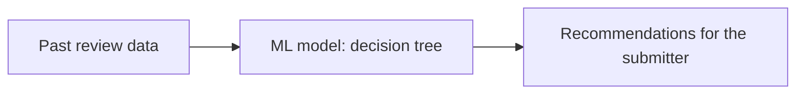

# A Recommendation System for Permit Submitters

DSC 180 · Domain D42 · Week 5 update
Shant · Alyx · Adit

---

## 1. Problem Statement

### Background: Stakeholder & Problem Statement

**Stakeholder: DSD** The City of San Diego's Development Services Department (DSD) reviews plans and issues permits for construction and development projects, then inspects the work.

**The Problem** Resubmittal cycles are high. Applicants submit, get comments back, fix things, and resubmit, and every round adds more review time for the City and more waiting for the applicant.

---

## 2. Current Permit Application System

### What's the system like today?

- People have no clear idea what is needed for their permit to get approved.
- The information they need is too spread out for a normal person to know all of it.
- That leads to many resubmittals, and money and time spent getting nowhere.
- Applicants get frustrated, and the City wastes money and resources on repeat reviews.

> **Early Evidence (exploratory, preliminary):** permits that need plan review take about 100 days, and frequent filers get building permits in about 20 days versus about 100 for everyone else. Experience seems to matter, which fits the idea that knowing what to include is the hard part.

---

## 3. Proposed Solution

### A recommendation system for submitters

A tool that tells people what to look out for and what they need to include for their specific type of permit.

**Building Process**

**Data**: reviews & comments from previous applicants
- Train an ML model on the review data to look for patterns by permit type and by location.
- Build a recommendation tool for applicants to make sure that they have all their requirements met to reduce potential common delays.
- Currently leaning toward a decision tree (a decision model).

---

## 4. Impact

- Reduces friction on both sides: easier for submitters and applicants, and less time and money spent by both the applicant and the City.
- Faster turnaround, not just for this permit but for others too, because fewer repeat reviews free up reviewers.
- A speedup in the overall permitting system.

---

## 5. Roadmap

### Timeline

- **Week 4: Thu, Oct 22:** Received the data.
- **Week 5: Mon, Oct 26:** Check in with Ben (TA) and Bijan / Capstone Panel.
- **Week 5: Tue, Oct 27:** Meet with the DSD team, David and Mazen.
- **Week 5: Thu, Oct 29:** Preliminary model ready to test.

---

Preliminary analysis of unvalidated data · not official City of San Diego or DSD findings
