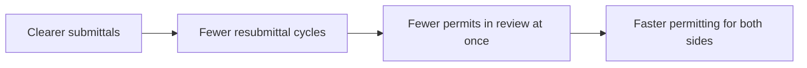

# Cutting Resubmittal Cycles in San Diego Permitting

**DSC 180 · Domain D42 · Week 5 Update: Field Trip Debrief & Stakeholder Vetting**
Shant · Alyx · Adit

> Preliminary analysis of unvalidated data. Not official City of San Diego or DSD findings.

---

## 1. Field trip debrief: who we met

| Stakeholder | Where |
|---|---|
| **City of San Diego, Performance Analytics team** | Met at the City building |
| **David, Development Services Department (DSD)** | Our direct contact on the permitting side |

**What we took away**

- [Takeaway 1: where they see the most friction in permitting]
- [Takeaway 2: what they already track or measure]
- [Takeaway 3: what would be most useful to them from us]

---

## 2. The problem: two kinds of permits

| | Simple permits | Plan-review permits |
|---|---|---|
| **Examples** | Solar, traffic control | Anything needing plan review |
| **Turnaround** | **Same day** | **~100 days** |

Plan review is where the waiting happens, and every resubmittal sends a permit back through another round of review.

Source: team exploratory permit analysis (turnaround by type). Preliminary.

---

## 3. Our focus: fewer resubmittal cycles

**Impact hypothesis (to vet with DSD):** fewer resubmittals free up reviewer time and cut waiting for applicants. Next we put numbers on it, in staff hours and days saved.

---

## 4. How to read the data: why the City looks faster than it is

**~21% of permits are not done yet.**

- The slow permits are the ones still waiting, so they are missing from the averages and the City looks faster than it is (this is called *censoring*).
- The "slow case" line dropping over the year is this same effect, not the City getting faster.
- Volume is steady at about **5–6k permits a month**.

<!-- Optional: add the pending-by-month chart here -->
<!--  -->

---

## 5. Early findings: what drives wait time

| Finding | Number | What it means |
|---|---|---|
| **Bigger projects wait longer** | Correlation of **0.53** between project cost and wait time | Cost and wait rise together moderately. Cost alone does not explain the wait. |
| **Experienced applicants are faster** | **~20 days** vs **~100 days** for building permits | Frequent filers get permits in about 20 days. Everyone else waits about 100. |

**So what:** experienced applicants know what a good submittal looks like. That is what we want our model to teach everyone else.

Note: the applicant figure moved from ~25 to ~20 days versus the full notebook because this summary uses simpler name cleanup, which groups a few applicants differently. Preliminary.

<!-- Optional: add the cost vs. wait-time chart here -->
<!--  -->

---

## 6. Technical approach (draft)

**Goal:** use past review data to build a model that tells submitters what to include in their proposal and what to look out for.

| Data source | What it gives us |
|---|---|
| **Reviews** | Review cycles per discipline, review days, outcomes (e.g. Recheck Required vs. Signed Off) |
| **Project Possession** | City time vs. applicant time per project |
| **Projects + Approvals** | Project type, scope, status, key dates |
| **Project Tags** | Program flags (e.g. ADU, affordable housing) |

Reviews are the core table. The source extract is raw and unvalidated, so all results are preliminary.

---

## 7. Next steps & roadmap

**Immediate**

1. Pull the 2020–2024 permit data
2. Focus on plan-review permits
3. Draft a list of possible predictors
4. Identify a faculty or grad advisor for the modeling approach

**Timeline to the proposal**

| Week | Focus |
|---|---|
| 6 | Technical scoping, advisor outreach |
| 7 | Q2 roadmap, schedule stakeholder meetings |
| 8 | First full draft of plan and slides |
| 9 | Polish and Q&A prep |
| 10 | **Dec 4: proposal due, present to the City** |

---

## 8. Where we'd like your input

1. Is "fewer resubmittal cycles" the right framing of business impact for City leadership?
2. Who else at the City or County should we talk to before Winter?
3. Do you know a faculty or grad advisor who could help with the modeling approach?

**Questions?**
